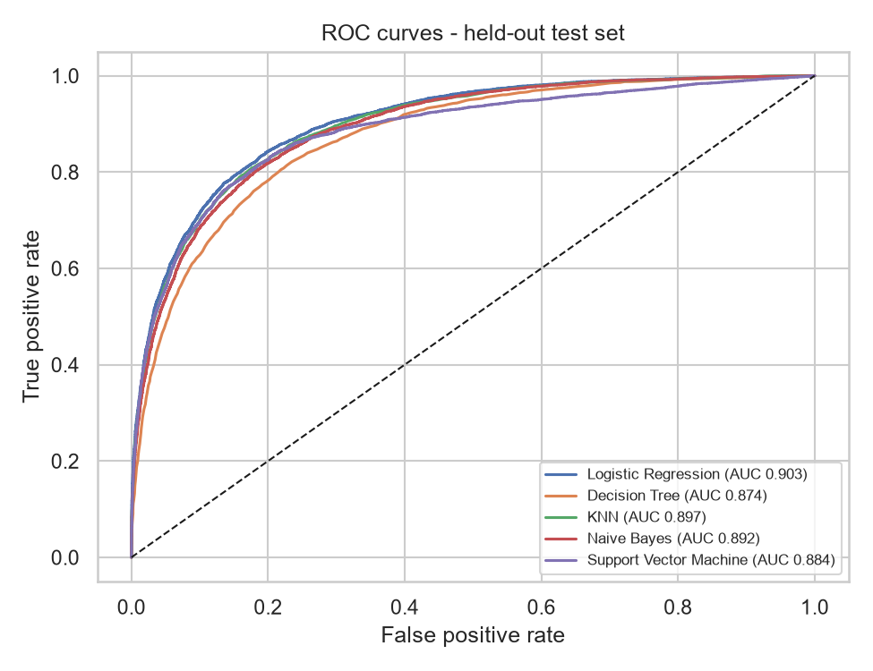

# Student Dropout Risk Prediction - Five Classifiers + Streamlit App

**GitHub Repository:** https://github.com/Vishwa-Santhosh/student-dropout-risk-ml-bitswilp  
**Live Streamlit app:** https://student-dropout-risk-ml-bitswilp-vxu8yppycx2kbdug6ruwfn.streamlit.app/

## a. Problem statement

Universities lose students every year, and the cost (to the student and the institution) is highest when a dropout is noticed too late. Hence why, this project builds and compares five classical supervised classifiers that predi    ct, from a student's academic, behavioural and socio-economic record, whether the student will **drop out** (`dropout` = 1) or **stay enrolled** (`dropout` = 0).

It is a **binary classification** problem with a moderately imbalanced target (about 32% dropouts), so accuracy alone is not enough: each model is judged on Accuracy, AUC, Precision, Recall, F1 and the Matthews Correlation Coefficient (MCC). The project delivers trained and saved scikit-learn pipelines, a reproducible training script, and a Streamlit web app that scores an uploaded test CSV with the saved models (without retraining) and shows the metrics, confusion matrix and classification report.

## b. Dataset description

| Item | Answer |
|---|---|
| Dataset name and source | Student Dropout Risk 2026 (`student_dropout_risk_2026.csv`), downloaded from Kaggle. https://www.kaggle.com/datasets/mohankrishnathalla/student-academic-performance-and-dropout-risk?resource=download |
| Type of problem | Binary classification |
| Number of instances | 100,000 students |
| Number of features | 32 predictors (27 numeric, including 0/1 flags; 5 categorical: gender, nationality, family_income_level, course_type, study_mode). The raw file has 34 columns = 32 features + `person_id` (identifier, dropped) + target. |
| Target variable and its classes | `dropout`: 1 = student dropped out (positive class), 0 = stayed enrolled |
| Missing values / duplicates and how handled | 0 missing cells and 0 duplicate rows (ignoring the id). The pipeline still contains imputers (median for numeric, most-frequent for categorical) so an uploaded file with blanks does not crash the app. |
| Preprocessing | `person_id` dropped. Numeric: median imputation + StandardScaler. Categorical: most-frequent imputation + one-hot encoding (unknown categories ignored) -> 56 model inputs. All steps live inside each saved scikit-learn Pipeline and are fitted on the training split only (no data leakage). |
| Train / test split ratio, stratification and random seed | 80 / 20 (80,000 train / 20,000 test), stratified on `dropout`, random_state = 42. The test split is saved as `test_data.csv`. |
| Class distribution | Stayed / dropout - Full: 67,996 / 32,004 (68.00% / 32.00%)<br>Train: 54,397 / 25,603 (68.00% / 32.00%)<br>Test: 13,599 / 6,401 (68.00% / 32.01%) |

## c. GitHub repository link

https://github.com/Vishwa-Santhosh/student-dropout-risk-ml-bitswilp

Repository contents:

- `app.py` - Streamlit app (loads the saved models; never retrains)
- `training.py` and `common.py` - source code: preprocessing, tuning, training, evaluation, model export
- `requirements.txt` - pinned dependencies
- `README.md` - this document
- `test_data.csv` - the 20,000-row hold-out test set (32 features + target) used in all experiments
- `model/` - five saved pipelines (`logistic_regression`, `decision_tree`, `knn`, `naive_bayes`, `svm` `.joblib`) plus `metrics.csv` and `metadata.json`
- `data/` - the full dataset so that `python training.py` is reproducible; `assets/` - ROC / confusion-matrix plots

## d. Models used

- **Logistic Regression** - linear model, L2 regularisation, C = 0.01 chosen by 3-fold CV.
- **Decision Tree** - max_depth = 10, min_samples_leaf = 300 chosen by 3-fold CV.
- **K-Nearest Neighbor** - k = 501 chosen by 3-fold CV on scaled, one-hot features.
- **Naive Bayes** - Gaussian Naive Bayes with default settings.
- **Support Vector Machine** - RBF kernel, C = 1, gamma = 'scale' (defaults; tuning is O(n^2) in rows and too slow on 80,000 samples). AUC uses the signed decision score.
- Tuning used stratified 3-fold cross-validation on the training split only, optimising ROC AUC; the test set was never used for any choice.

### Model comparison table (held-out test set, 20,000 students)

| Model Name | Accuracy | AUC | Precision | Recall | F1 | MCC |
|---|---|---|---|---|---|---|
| Logistic Regression | 0.8405 | 0.9031 | 0.7827 | 0.6944 | 0.7359 | 0.6245 |
| Decision Tree | 0.8128 | 0.8741 | 0.7468 | 0.6282 | 0.6824 | 0.5553 |
| KNN | 0.8190 | 0.8974 | 0.8620 | 0.5173 | 0.6466 | 0.5664 |
| Naive Bayes | 0.8207 | 0.8923 | 0.7023 | 0.7636 | 0.7317 | 0.5986 |
| Support Vector Machine | 0.8365 | 0.8838 | 0.7975 | 0.6557 | 0.7197 | 0.6116 |

Best value per column: Accuracy, AUC, F1, MCC - Logistic Regression; Precision - KNN; Recall - Naive Bayes. Positive class = dropout (1); threshold 0.5 (SVM: decision score > 0).

### Confusion-matrix counts

| Model Name | TN | FP | FN | TP |
|---|---|---|---|---|
| Logistic Regression | 12,365 | 1,234 | 1,956 | 4,445 |
| Decision Tree | 12,236 | 1,363 | 2,380 | 4,021 |
| KNN | 13,069 | 530 | 3,090 | 3,311 |
| Naive Bayes | 11,527 | 2,072 | 1,513 | 4,888 |
| Support Vector Machine | 12,533 | 1,066 | 2,204 | 4,197 |



### Observations on model performance

| Model Name | Observation about model performance |
|---|---|
| Logistic Regression | Best overall: highest Accuracy (0.8405), AUC (0.9031), F1 (0.7359) and MCC (0.6245). It finds 4,445 of the 6,401 real dropouts (recall 0.6944) with 1,234 false alarms. Strong regularisation (C = 0.01) was preferred, which suggests the signal is largely additive and linear. Also, the fastest to train and the smallest file. |
| Decision Tree | Weakest model: lowest Accuracy (0.8128), AUC (0.8741) and MCC (0.5553); it misses 2,380 dropouts. Pruning to depth 10 with at least 300 samples per leaf was needed to stop over-fitting. It is easy to explain as rules, but a single tree cannot match a smooth, additive risk signal. |
| KNN | Most conservative model: highest Precision (0.8620, only 530 false alarms) but the lowest Recall (0.5173) - it misses 3,090 of 6,401 dropouts - and therefore the lowest F1 (0.6466). CV chose a very large k (501), i.e. heavy smoothing, because individual neighbours are noisy. AUC is second best (0.8974). Slowest to score and its saved file is large because it stores the training set. |
| Naive Bayes | Highest Recall (0.7636): it catches 4,888 of 6,401 dropouts, at the price of the lowest Precision (0.7023; 2,072 false alarms). F1 (0.7317) is second best and AUC (0.8923) third, despite the independence assumption being violated by correlated features (GPA, units passed, attendance). Trains in under a second - a good choice when missing a dropout is costlier than a false alarm. |
| Support Vector Machine | Second in Accuracy (0.8365) and MCC (0.6116), third in F1 (0.7197), but AUC (0.8838) is below Logistic Regression, KNN and Naive Bayes. It needed about 3.5 minutes to train and roughly a minute to score 20,000 rows, so the non-linear RBF kernel adds cost without a gain over the linear model. Default hyper-parameters were used, so a tuned SVM might close part of the gap. |
| The Winner? | **Logistic Regression** - it ranks first on 4 of the 6 metrics (Accuracy, AUC, F1, MCC), is the simplest and fastest, and is the best-balanced choice. Metric-specific leaders: Precision - KNN (0.8620); Recall - Naive Bayes (0.7636). If the aim is early warning (catch as many at-risk students as possible), Naive Bayes or Logistic Regression with a lower threshold fits better; if interventions are expensive and must be targeted, KNN's precision is attractive. |

## Streamlit application

The app (`app.py`) is deployed on Streamlit Community Cloud. It loads the five saved pipelines from `model/`, scores the uploaded CSV and displays the results. It never calls `fit()`: the uploaded data is used only for prediction.

| Required feature | Implemented? |
|---|---|---|
| Dataset upload option | Sidebar file uploader accepts a CSV. It validates that all 32 feature columns and the `dropout` target are present (clear error otherwise). A download button provides `test_data.csv`, and a checkbox uses the bundled copy for a quick demo. |
| Model selection dropdown | Sidebar dropdown with Logistic Regression, Decision Tree, KNN, Naive Bayes and Support Vector Machine; a short description of the selected model is shown. |
| Display of evaluation metrics | Six metric cards (Accuracy, AUC, Precision, Recall, F1, MCC) for the selected model, plus a benchmark tab with the metrics of all five models. |
| Confusion matrix or classification report | Both are shown: a heat-mapped confusion matrix (counts and row %) and a per-class classification report. Additional: ROC curve and a downloadable predictions table. |

- Uploaded `test_data.csv` (20,000 rows) gives exactly the metrics in the comparison table above for every model (verified).
- KNN scores 20,000 rows in roughly 10-15 s and SVM in roughly 1 minute; results are cached after the first run.
- A warning appears if the runtime scikit-learn version differs from the version used for training.

## Project structure

```
app.py            Streamlit app
training.py       training / tuning / evaluation / export
common.py         metric + scoring helpers shared by training.py and app.py
requirements.txt  pinned dependencies (Python 3.12)
test_data.csv     hold-out test set
data/             full dataset
model/            5 x .joblib pipelines, metrics.csv, metadata.json
assets/           plots
```

## Run it yourself

```bash
python -m venv .venv && source .venv/bin/activate      # Windows: .venv\Scripts\Activate.ps1
pip install -r requirements.txt
python training.py          # ~6-10 min; regenerates model/, test_data.csv, assets/
streamlit run app.py        # then upload test_data.csv
```

## Notes and limitations

- Reproducibility: fixed seed (42) and pinned library versions; the saved pipelines must be loaded with the same scikit-learn version (the app warns otherwise).
- SVM and Naive Bayes use default hyper-parameters; the other three were tuned by cross-validation on the training split only.
- The dataset contains sensitive attributes (gender, nationality, disability status, mental-health support). The models are for coursework analysis only and must not be used to make decisions about individual students.
